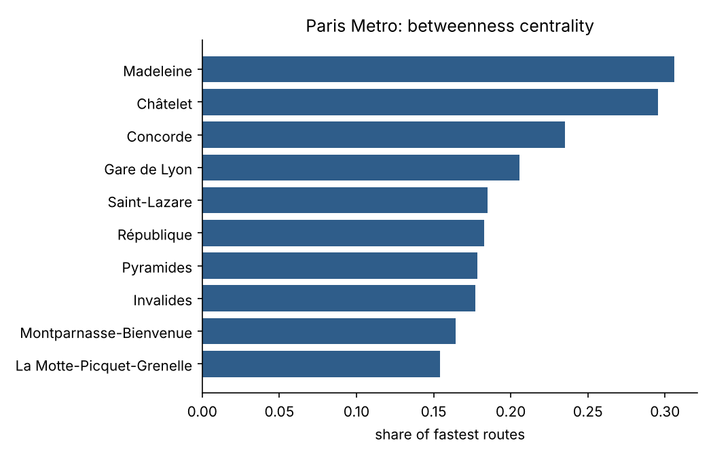

# Paris Metro as a Graph

Graph analysis of the Paris Metro network in Python: fastest routes between any two stations, and which stations matter most for the network.

The core algorithms (Dijkstra, PageRank, Brandes' betweenness centrality) are implemented **from scratch** and tested against [networkx](https://networkx.org/).

## Results

The network has **302 stations, 759 platforms and 2,427 connections** (rides between consecutive stations and walking transfers inside a station, weighted by time in seconds).

**Which stations carry the most fastest routes?** Madeleine and Châtelet sit on about 30% of all fastest journeys between two stations.



| Measure | Top stations |
| --- | --- |
| Degree (direct neighbours) | Montparnasse-Bienvenue (9), République (8), Châtelet (8) |
| Betweenness centrality | Madeleine (0.31), Châtelet (0.30), Concorde (0.24) |
| PageRank | Montparnasse-Bienvenue, République, Châtelet |
| Lowest average travel time to all stations | Châtelet (17.6 min), Madeleine (18.4 min), Opéra (18.8 min) |

The longest "fastest journey" in the network is **Pont de Sèvres → Pointe du Lac, about 84 minutes**.

Degree and PageRank reward big interchange hubs, while betweenness highlights stations on the fast line 14 corridor (Madeleine, Pyramides, Gare de Lyon), which many optimal routes use as a shortcut through the centre.

## Usage

```bash
pip install -r requirements.txt

python route.py "Châtelet" "Nation"
python route.py "la defense" "gare de lyon"   # accents and case are optional
python analyze.py                              # prints the analysis, writes figures/
python -m pytest                               # runs the tests
```

Example:

```
La Défense (Grande Arche) -> Gare de Lyon: about 33 min
  Line 1: La Défense (Grande Arche) -> Châtelet (14 stops)
  Change at Châtelet -> line 14
  Line 14: Châtelet -> Gare de Lyon (1 stop)
```

## How it works

**Model.** Each node is a *platform* (a station on one line, in one direction), so changing lines costs a transfer time. A route between two stations is a multi-source, multi-target shortest path: Dijkstra starts from every platform of the departure station at distance 0 and stops at the closest platform of the arrival station.

**Algorithms** (`metro/algorithms.py`):

- **Dijkstra** with a binary heap, O((V + E) log V).
- **PageRank** by power iteration: r(v) = (1 − d)/N + d · Σ r(u)/outdeg(u), with d = 0.85 and dangling nodes spread uniformly.
- **Betweenness centrality** with Brandes' algorithm for weighted graphs, O(VE + V² log V).

**Tests** (`tests/`) compare each algorithm with networkx on random graphs and check routes on the real network.

## Project structure

```
metro/network.py      load the data, build the platform graph and the station graph
metro/algorithms.py   Dijkstra, PageRank, betweenness (from scratch)
route.py              command-line route planner
analyze.py            network analysis and figures
tests/                tests against networkx
data/                 stations and connections (CSV)
```

## Data and limits

The data comes from RATP open data, as compiled in [AissamDjahnine/Metro-Problem-](https://github.com/AissamDjahnine/Metro-Problem-). It is an older snapshot: it does not include recent extensions such as line 14 to Saint-Denis Pleyel and Orly (2024), line 11 to Rosny (2024), line 4 to Bagneux (2022) or line 12 to Aubervilliers (2022). Travel times are scheduled minimums, not real-time.

## Next steps

- Update the network with the current Île-de-France Mobilités GTFS feed and station coordinates.
- Draw routes and centrality on an interactive map.
- Measure network resilience: which station closures increase average travel time the most.
